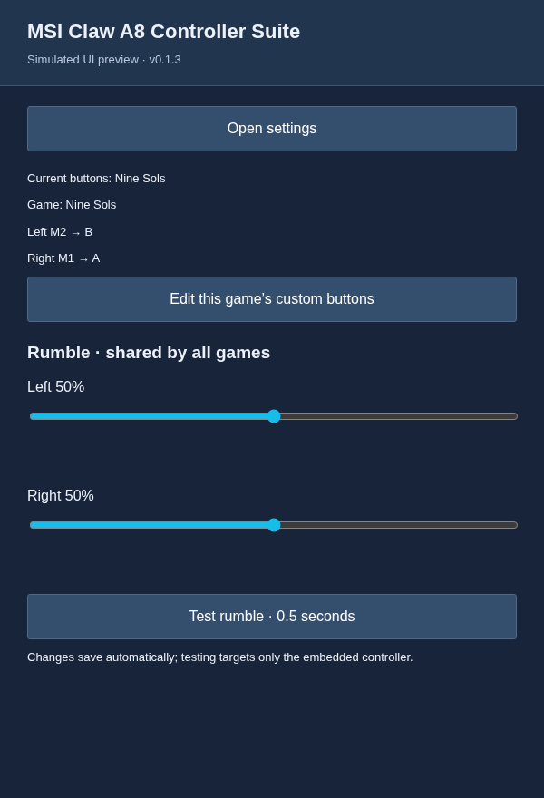
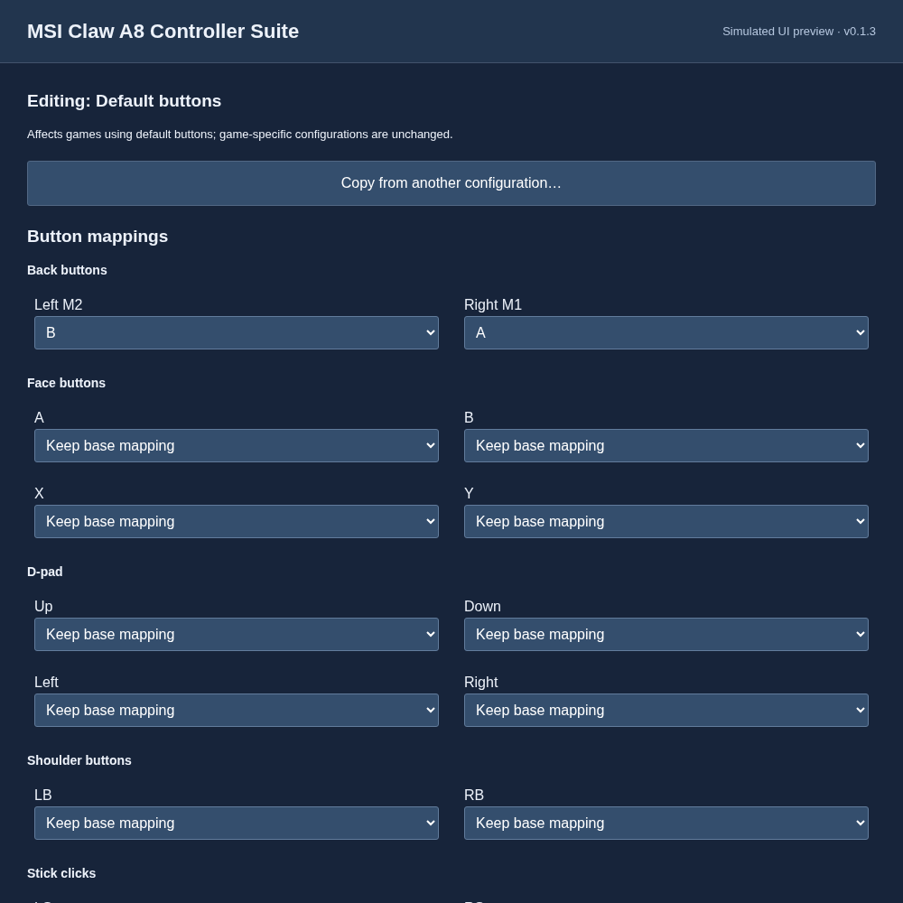
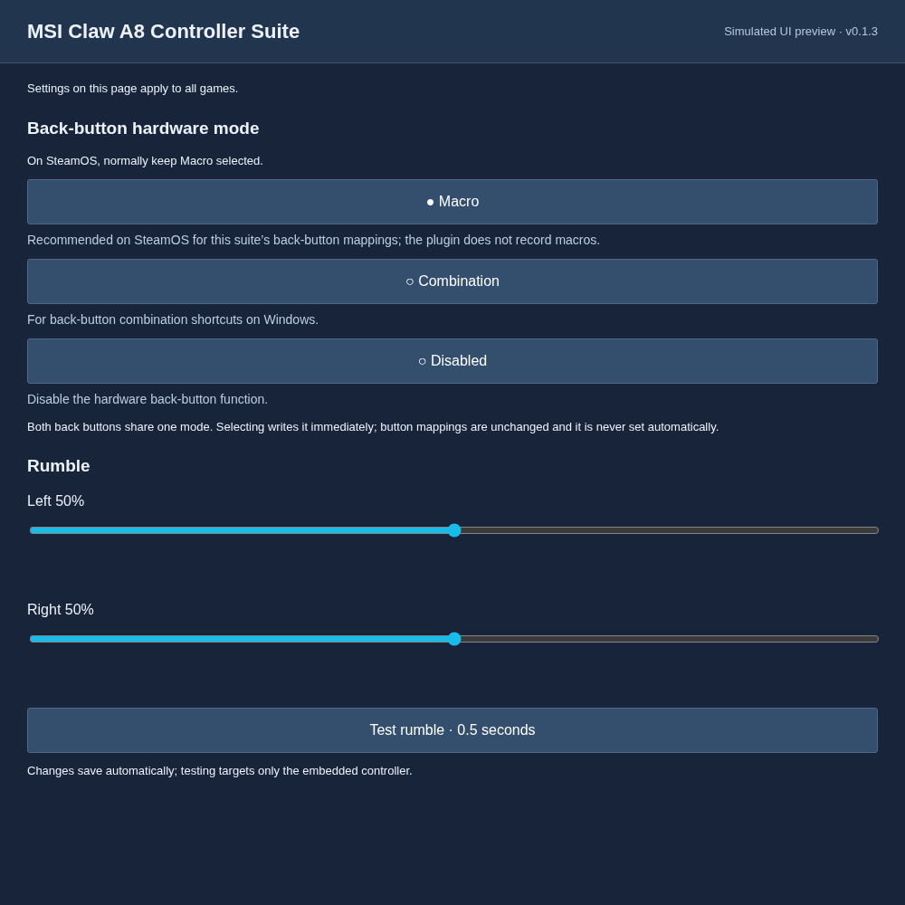
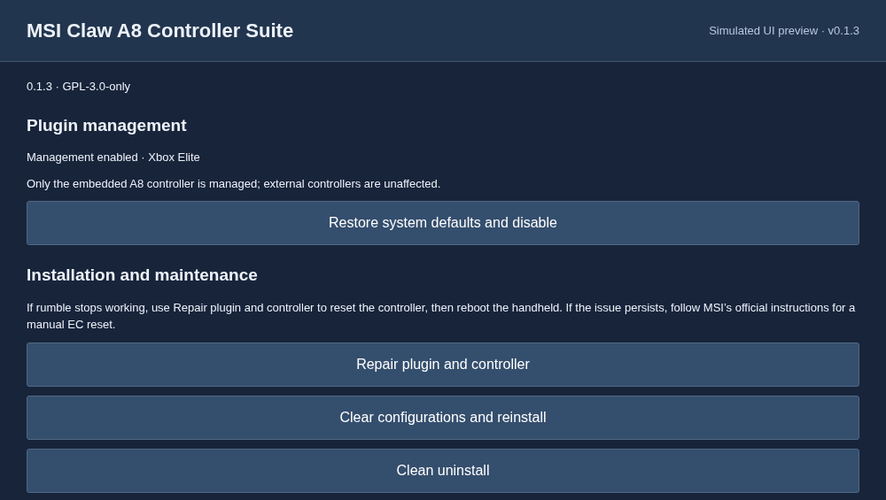

# MSI Claw A8 Controller Suite

A Decky plugin for the embedded controller on **MSI Claw A8 (BZ2EM / MS-1T8K)**. Community software, not an MSI product; other Claw models are outside the supported scope.

[简体中文](README.zh-CN.md)

## Interface preview

Simulated previews rendered from the plugin's UI components with sample data. Steam's native appearance may differ.

| Home (quick panel) | Button mappings |
| --- | --- |
|  |  |

| Controller settings | Maintenance & About |
| --- | --- |
|  |  |

## Features

- **Button remapping:** remap the built-in controller's buttons, including Left M2 and Right M1, to controller buttons, keyboard keys or mouse buttons.
- **Default and per-game configurations:** keep a shared default layout, create custom layouts for individual games, and copy mappings between configurations.
- **Rumble adjustment and testing:** adjust left and right rumble strengths separately and send a short test pulse to the built-in controller. Changes save automatically and apply across games.
- **Back-button hardware modes:** switch between Macro, Combination and Disabled. Macro is recommended on SteamOS; Combination provides back-button shortcuts on Windows.
- **Rumble repair:** use Repair plugin and controller to reinstall the plugin and software-reset the built-in controller while keeping your mappings. Reboot the handheld afterward to complete recovery.
- **Manual update checks:** check for the latest stable release from the bottom of the home panel or the top of Maintenance & About. If an update is available, open the repository to install it. There are no background update checks.

Management is enabled on first install. Restore system defaults and disable returns the built-in controller to the system's default configuration and keeps management disabled until you enable it again. External controllers are unaffected.

## Install and update

**Prerequisites:** Install [Decky Loader](https://github.com/SteamDeckHomebrew/decky-loader) and disable all other controller-management plugins, such as DeckyPlumber.

### Online installation

This fixed command installs or updates to the latest published stable release.

Run as your normal desktop user in SteamOS Konsole:

```sh
curl -fsSL https://raw.githubusercontent.com/sekirofly/msi-claw-a8-controller-suite/main/install-latest.sh | bash
```

The installer verifies the release SHA-256 and restarts Decky. Updates retain mappings and management preference without resetting the controller. Save work, reboot the handheld and check plugin status. Installation completion does not confirm that mappings were applied. For a custom Decky home, use `bash -s -- install --decky-home /absolute/homebrew`.

### Offline installation

1. On a connected device, download the `msi-claw-a8-controller-suite.zip` release asset from [Releases](https://github.com/sekirofly/msi-claw-a8-controller-suite/releases/latest). **Do not use GitHub's Source code archives.**
2. Copy the ZIP to the handheld, for example into `~/Downloads/`, using a USB drive. Keep the ZIP intact; do not extract it.
3. Open Decky Settings → General and enable Developer mode.
4. Open Developer → Install Plugin from ZIP File → Browse, select the local ZIP, and confirm Decky's installation prompts.
5. Save work, reboot the handheld after installation, and check plugin status.

This path does not run `install.sh`. The ZIP includes the prebuilt plugin and its required Python dependencies, so installation requires no network downloads.

<details>
<summary>Optional: verify the downloaded file</summary>

Download `msi-claw-a8-controller-suite.zip.sha256` from the same release and put it alongside the ZIP. Run the following in desktop-mode Konsole to check for download or transfer corruption. Decky's local ZIP installer does not require this file.


```sh
cd ~/Downloads
sha256sum -c msi-claw-a8-controller-suite.zip.sha256
```

</details>

This is Decky's built-in local installation path; no separate package is needed. The in-plugin Repair plugin and controller and Clear configurations and reinstall actions still download a release over the network.

## Maintenance and removal

| Action | Mappings | Controller |
| --- | --- | --- |
| Repair plugin and controller | Retain | Reinstall files and software-reset the internal controller |
| Clear configurations and reinstall | Delete default and all game configurations | Reinstall files and software-reset the controller |
| Clean uninstall | Delete | Restore system defaults, then remove plugin |

After confirming, wait for Decky to restart. The first two actions also require a **full handheld reboot**. Hardware mode and rumble strengths are not backed up/reapplied and may return to device defaults.

Terminal alternatives (`reinstall` clears mappings but retains the management choice):

```sh
# Clear mappings, reinstall and reset controller; reboot afterward
curl -fsSL https://raw.githubusercontent.com/sekirofly/msi-claw-a8-controller-suite/main/install-latest.sh | bash -s -- reinstall --reset-controller
# Uninstall
curl -fsSL https://raw.githubusercontent.com/sekirofly/msi-claw-a8-controller-suite/main/install-latest.sh | bash -s -- uninstall
# Offline uninstall using installed files
python3 ~/homebrew/plugins/msi-claw-a8-controller-suite/installer.py uninstall
```

Failed uninstall restoration preserves the installation. `--skip-restore` explicitly bypasses restoration. Legacy recovery.json files are backups only, archived under `~/homebrew/.msi-claw-a8-controller-suite-recovery/` before clearing configuration.

## Troubleshooting

Inspect diagnostics and retry messages in Maintenance. For lost rumble, repair the plugin/controller and reboot. If ineffective, follow [MSI's EC reset instructions](https://www.msi.com/support/technical_details/HH_EC_Reset). Software controller reset is not established as equivalent to a full EC reset.

```sh
sudo bash ~/homebrew/plugins/msi-claw-a8-controller-suite/diagnostics.sh
journalctl -u msi-claw-a8-controller-suite-maintenance --no-pager -n 100
```

Diagnostics are read-only and local. `game_tracking: events` means observed game changes; `compatibility-5s` checks frontend state every five seconds without backend calls/device writes when unchanged. calls.log plus one backup is bounded near 128KiB; successful state reads stay in memory. Decky/system logs follow host policies.

Installed defaults use profiles/default.yaml and devices/50-msi_claw_a8_bz2e.yaml under `/usr/local/share/inputplumber` when present, otherwise `/usr/share/inputplumber`. Third-party `/etc` overrides are not treated as defaults. Pure-Python PyYAML is bundled; system Python is not modified.

## Development and license

```sh
pnpm install --frozen-lockfile
pnpm run typecheck
pnpm run build
node --test tests/frontend.cjs
python3 -m unittest discover -s tests -v
python3 scripts/check_versions.py
```

Packaging requires PyYAML 6.0.3: run scripts/package.py and scripts/verify_package.py. CI also checks Python 3.11/3.13, Ruff and shell syntax.

GPL-3.0-only. Dependencies and original project attribution: [THIRD_PARTY.md](THIRD_PARTY.md). [Design](docs/design.zh-CN.md), [integration review](docs/integration-review.zh-CN.md) and [research](docs/research.md) remain historical references.

## Acknowledgments

- [DeckyPlumber](https://github.com/aarron-lee/DeckyPlumber) by aarron-lee and its contributors, for the architectural and InputPlumber API usage reference.
- [InputPlumber](https://github.com/ShadowBlip/InputPlumber), which provides controller input processing and virtual device support.
- [Decky Loader](https://github.com/SteamDeckHomebrew/decky-loader), which provides the plugin platform and Steam UI integration.
- [MSI Claw A8 Back Buttons & Rumble](https://github.com/sekirofly/msi-claw-a8-back-buttons-rumble), the original hardware-control implementation this suite builds on.

Source provenance, reuse details and license notices are recorded in [THIRD_PARTY.md](THIRD_PARTY.md) and [third_party/](third_party/).
