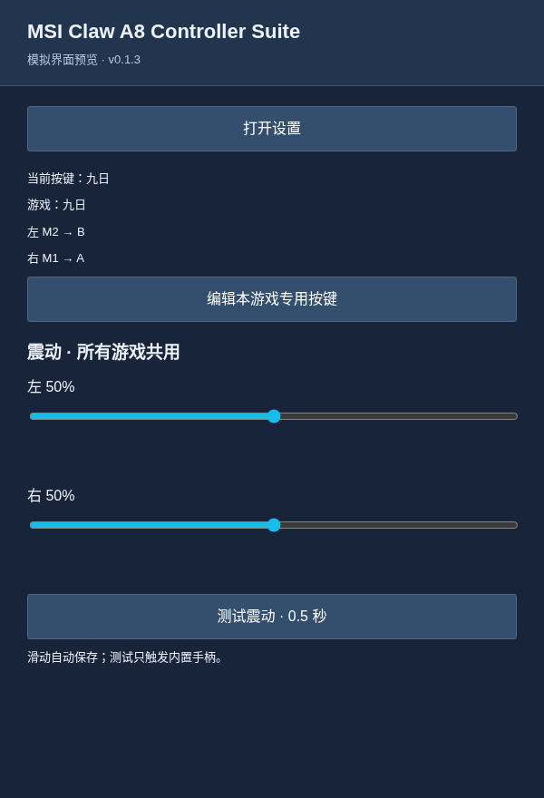
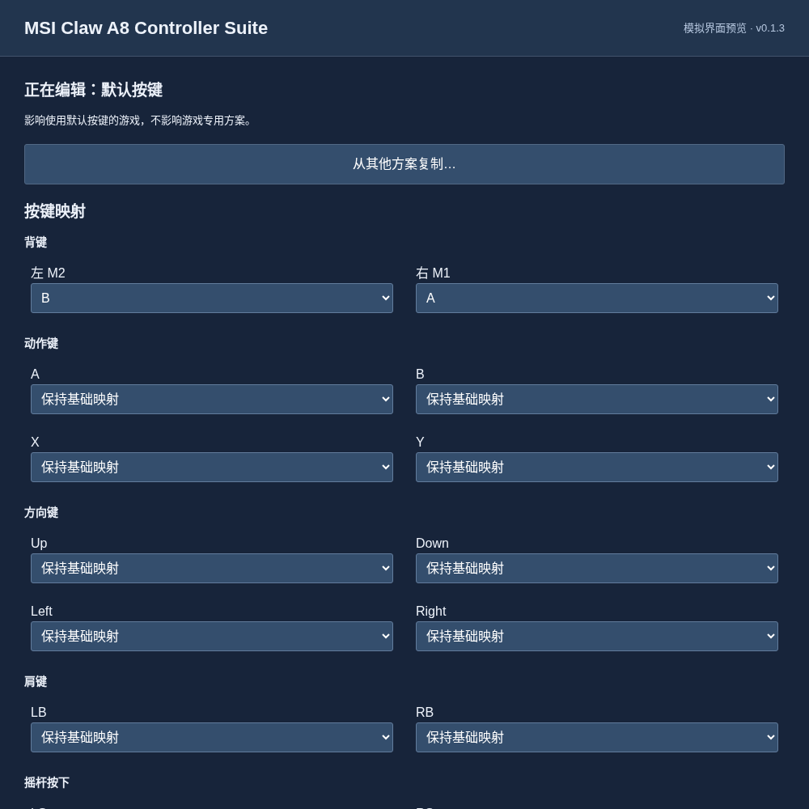
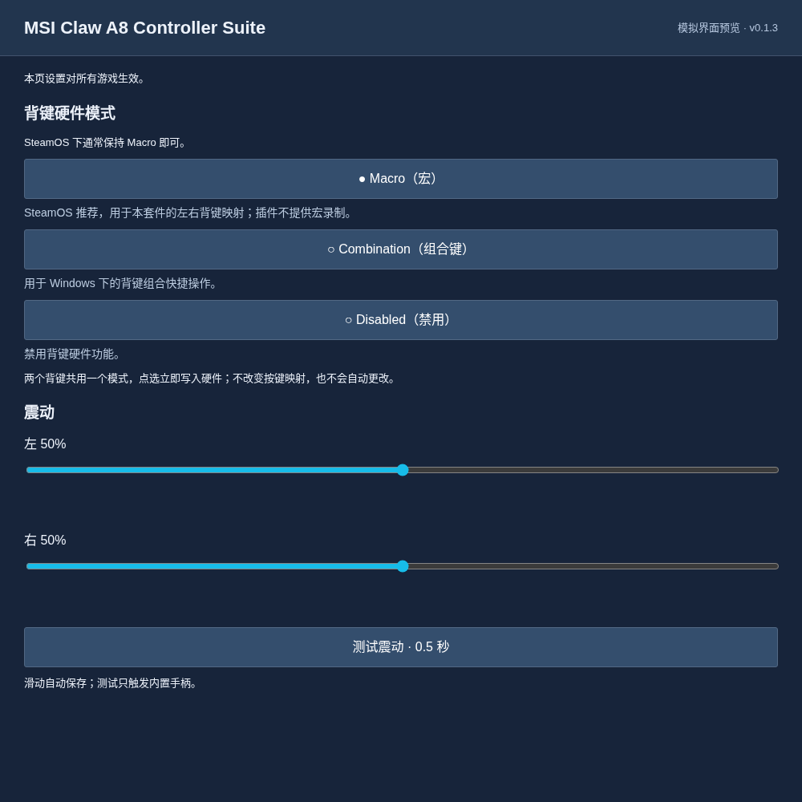
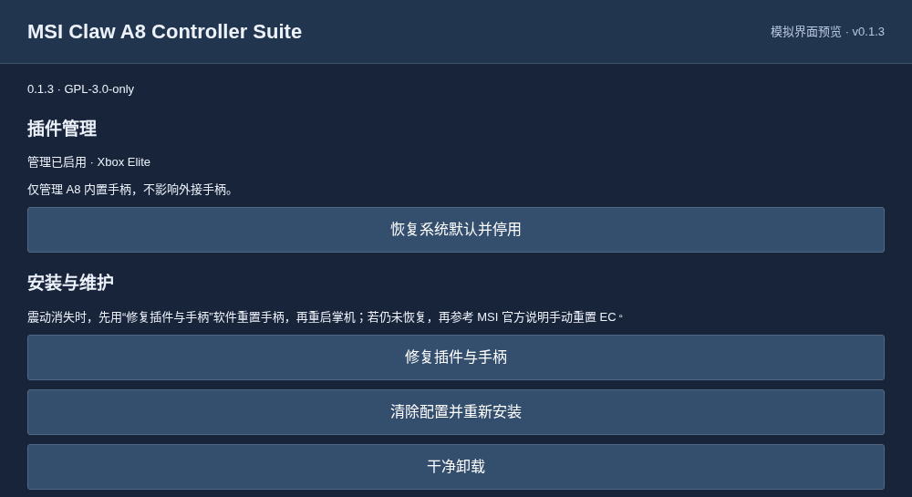

# MSI Claw A8 Controller Suite

MSI Claw A8（BZ2EM / MS-1T8K）内置手柄的 Decky 插件。本项目非 MSI 官方产品，不支持将其他 Claw 型号视为已兼容设备。

[English](README.md) · [实现状态](docs/implementation-status.md)

## 界面预览

以下为使用插件实际界面组件和示例数据生成的模拟预览，Steam 原生外观可能略有不同。

| 主页（快捷面板） | 按键映射 |
| --- | --- |
|  |  |

| 手柄设置 | 维护与关于 |
| --- | --- |
|  |  |

## 功能

- **按键映射：**将内置手柄按键（包括左 M2、右 M1）映射为手柄按键、键盘按键或鼠标按键。
- **默认与游戏专用方案：**设置通用的默认按键，为不同游戏创建专用方案，并在方案之间复制映射。
- **震动调整与测试：**分别调整左右震动强度，并向内置手柄发送短暂震动进行测试。调整自动保存，对所有游戏生效。
- **背键硬件模式：**提供 Macro、Combination、Disabled 三种模式的切换入口。SteamOS 推荐使用 Macro；Combination 用于 Windows 下的背键组合快捷操作。
- **震动修复：**通过“修复插件与手柄”保留按键方案、重新安装插件并软件重置内置手柄，再重启掌机完成恢复。

首次安装默认启用管理。选择“恢复系统默认并停用”后，内置手柄恢复系统默认配置，管理保持停用，直到再次启用。外接手柄不受影响。

## 安装与更新

需要已安装 Decky，并停用原 DeckyPlumber、独立背键/震动插件，避免同时修改设备。SteamOS 桌面模式打开 Konsole，以普通用户运行：

```sh
curl -fsSL https://raw.githubusercontent.com/sekirofly/msi-claw-a8-controller-suite/v0.1.3/install.sh | bash
```

安装器校验发行包 SHA-256 并重启 Decky。覆盖更新保留按键方案和管理选择，不自动重置手柄。保存工作并重启掌机后检查插件状态；安装成功不等于配置已应用。自定义 Decky 目录使用 `bash -s -- install --decky-home /绝对路径/homebrew`。

## 维护与卸载

| 操作 | 按键方案 | 手柄处理 |
| --- | --- | --- |
| 修复插件与手柄 | 保留 | 重装文件并软件重置内置手柄 |
| 清除配置并重新安装 | 删除默认和全部游戏方案 | 重装文件并软件重置内置手柄 |
| 干净卸载 | 删除 | 恢复系统默认后移除插件 |

确认后等待 Decky 自动重启。前两个操作还需要**正常重启整台掌机**才能完成手柄恢复；不保存或恢复硬件模式、震动强度，它们可能回到设备默认值。

终端入口（`reinstall` 清除按键方案，保留管理启用选择）：

```sh
# 清除方案、重装并软件重置手柄，完成后重启掌机
curl -fsSL https://raw.githubusercontent.com/sekirofly/msi-claw-a8-controller-suite/v0.1.3/install.sh | bash -s -- reinstall --reset-controller
# 卸载
curl -fsSL https://raw.githubusercontent.com/sekirofly/msi-claw-a8-controller-suite/v0.1.3/install.sh | bash -s -- uninstall
# 使用已安装文件离线卸载
python3 ~/homebrew/plugins/msi-claw-a8-controller-suite/installer.py uninstall
```

卸载恢复失败会保留安装。明确需要跳过恢复时可加 `--skip-restore`，此时设备状态不会恢复。旧 recovery.json 仅作备份，不参与运行；清除配置前归档到 `~/homebrew/.msi-claw-a8-controller-suite-recovery/`。

## 排查问题

先看“维护与关于”的诊断和重试提示。震动异常可使用“修复插件与手柄”并重启掌机；仍无效再参考 [MSI 官方 EC 重置说明](https://www.msi.com/support/technical_details/HH_EC_Reset)。软件手柄重置不等同于已确认的完整 EC 重置。

```sh
sudo bash ~/homebrew/plugins/msi-claw-a8-controller-suite/diagnostics.sh
journalctl -u msi-claw-a8-controller-suite-maintenance --no-pager -n 100
```

诊断只读取本地信息。`game_tracking` 为 `events` 时使用事件监听，否则为 `compatibility-5s`；后者状态不变时不调用后端或写设备。calls.log 与一个备份合计约 128 KiB，普通状态读取仅保留内存记录；宿主日志由 Decky/系统配置管理。

系统默认读取 InputPlumber 系统数据目录中的 `profiles/default.yaml` 和 `devices/50-msi_claw_a8_bz2e.yaml`，优先 `/usr/local/share/inputplumber`，再用 `/usr/share/inputplumber`。不采用第三方 `/etc` 覆盖作为默认。包内包含纯 Python PyYAML，不修改系统 Python。

## 开发与许可

```sh
pnpm install --frozen-lockfile
pnpm run typecheck
pnpm run build
node --test tests/frontend.cjs
python3 -m unittest discover -s tests -v
python3 scripts/check_versions.py
```

打包需要 PyYAML 6.0.3：运行 `python3 scripts/package.py` 和 `python3 scripts/verify_package.py`。CI 另检查 Python 3.11/3.13、Ruff 和 Shell 语法。

GPL-3.0-only；依赖及原项目来源见 [THIRD_PARTY.md](THIRD_PARTY.md)。[历史设计](docs/design.zh-CN.md)、[整合评审](docs/integration-review.zh-CN.md)与[研究记录](docs/research.zh-CN.md)仅作追溯。

## 致谢

- 感谢 aarron-lee 及贡献者维护的 [DeckyPlumber](https://github.com/aarron-lee/DeckyPlumber)，为本项目提供架构与 InputPlumber API 用法参考。
- 感谢 [InputPlumber](https://github.com/ShadowBlip/InputPlumber) 提供手柄输入处理与虚拟设备支持。
- 感谢 [Decky Loader](https://github.com/SteamDeckHomebrew/decky-loader) 提供插件平台与 Steam 界面集成。
- 本项目的硬件控制实现基于 [MSI Claw A8 Back Buttons & Rumble](https://github.com/sekirofly/msi-claw-a8-back-buttons-rumble)。

来源、复用范围和许可声明见 [THIRD_PARTY.md](THIRD_PARTY.md) 与 [third_party/](third_party/)。
